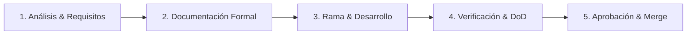

# Guía de Metodología de Desarrollo y Estándares de Ingeniería

> **Torcly · Manual Oficial de Ingeniería y Cultura de Entrega**  
> Esta guía establece el estándar de trabajo obligatorio para todos los desarrolladores y modelos de inteligencia artificial que colaboren en el proyecto. Ninguna línea de código entra a las ramas de integración sin haber cumplido este ciclo.

---

## 1. Filosofía de Trabajo y Ciclo de Vida del Software

En Torcly no se programa directamente en código sin una fase previa de análisis y diseño. Todo cambio, mejora o nueva funcionalidad sigue rigurosamente el **Ciclo de 5 Fases**:



1. **Fase 1: Análisis y Desglose Funcional**
   * Se analiza el dolor real del taller automotriz y el flujo de usuario.
   * Se divide el trabajo en Historias de Usuario (HU) con Criterios de Aceptación claros (formato GIVEN / WHEN / THEN).
   * Se evalúa si el cambio impacta a otros módulos para evitar efectos colaterales.

2. **Fase 2: Documentación Obligatoria (Antes de Codificar)**
   * Se crea la carpeta del sprint en `docs/03-sprints/sprint-XX-<nombre>/`.
   * Se redactan los documentos de arquitectura y pruebas antes de escribir código funcional.

3. **Fase 3: Git & Implementación Aislada**
   * Se crea una rama feature aislada a partir de la rama base acordada (`team/develop` o `develop`).
   * Se aplican estrictamente los componentes reutilizables y la arquitectura en capas.

4. **Fase 4: Verificación y Pruebas Manuales / Automáticas**
   * Ejecución obligatoria de typecheck estricto (`pnpm -r typecheck`).
   * Ejecución de suite de pruebas unitarias y de integración (`pnpm test`).
   * Ejecución paso a paso de la matriz de pruebas manuales en el navegador.

5. **Fase 5: Aprobación y Cierre**
   * Documentación de la evidencia en `approval.md`.
   * Apertura de Pull Request y fusión controlada.

---

## 2. Documentación Estándar de Sprints (`docs/03-sprints/`)

Cada sprint o epic de trabajo debe contar con su propia carpeta con nomenclatura:  
`docs/03-sprints/sprint-XX-<descripcion-corta>/`

Dentro de dicha carpeta, es **obligatorio** que existan los siguientes cuatro archivos:

| Archivo | Propósito y Contenido |
| :--- | :--- |
| **`README.md`** | **Visión general del sprint**: Objetivo del negocio, historias de usuario cubiertas, alcance cerrado, dependencias técnicas y modelo de datos impactado. |
| **`implementation-plan.md`** | **Plan técnico detallado**: Pasos de implementación ordenados, lista exacta de archivos a crear y modificar, contratos de API / DTOs, migraciones de base de datos y decisiones de diseño. |
| **`acceptance-and-test-plan.md`** | **Matriz de aceptación y pruebas**: Criterios de aceptación detallados, escenarios de prueba manuales paso a paso (precondición, pasos, resultado esperado), datos de prueba sugeridos y casos borde (edge cases). |
| **`approval.md`** | **Acta de cierre y verificación**: Evidencia de pruebas ejecutadas, resumen de resultados del typecheck y tests, capturas o notas de validación funcional y aprobación formal del sprint. |

> [!IMPORTANT]
> **Regla de oro para nuevos módulos**:  
> Cada vez que se crea un nuevo módulo en frontend (`apps/web/src/features/<modulo>/`) o en backend (`apps/api/src/modules/<modulo>/`), dicho módulo **DEBE** incluir su propio archivo `README.md` en la raíz de su carpeta explicando:
> 1. Responsabilidad y alcance del módulo.
> 2. Permisos requeridos (`permissions.ts`).
> 3. Entidades y contratos que expone.
> 4. Endpoints o rutas frontend asociadas.

---

## 3. Estructura de Carpetas y Arquitectura de Código

El proyecto es un monorepo gestionado con `pnpm` (`apps/web` y `apps/api`). La arquitectura sigue una separación estricta por características (**Feature-Driven Architecture**).

### 3.1. Frontend (`apps/web/src/features/<modulo>/`)

Cada módulo en la aplicación web debe mantener la siguiente estructura modular:

```text
apps/web/src/features/<modulo>/
├── components/          # Componentes de presentación (tablas, barras de herramientas, modales, widgets)
├── forms/               # Esquemas Zod y sub-componentes de formularios específicos
├── hooks/               # Custom hooks de React y queries/mutations de TanStack Query
├── pages/               # Páginas de enrutamiento (<modulo>-page.tsx, <modulo>-detail-page.tsx)
├── services/            # Clientes HTTP (llamadas vía apiClient a la API REST)
├── types/               # Definiciones de TypeScript, DTOs y tipos del dominio
├── utils/               # Funciones puras de formateo, cálculos y helpers locales
└── README.md            # Documentación obligatoria del módulo
```

### 3.2. Backend (`apps/api/src/modules/<modulo>/`)

Cada módulo en el backend debe mantener una separación limpia en capas:

```text
apps/api/src/modules/<modulo>/
├── controllers/         # Controladores Express / Fastify (manejo de req, res, status codes)
├── services/            # Lógica de negocio pura, reglas del taller y transacciones Prisma
├── dto/                 # Esquemas de validación Zod y tipos de entrada/salida
├── types/               # Tipos e interfaces de dominio interno
├── tests/               # Pruebas unitarias y de integración (*.spec.ts o *.test.ts)
└── README.md            # Documentación del módulo backend
```

---

## 4. Estándares de UI y Reutilización de Componentes

Para mantener una interfaz visualmente coherente, moderna y accesible, está **terminantemente prohibido reinventar la rueda** creando elementos HTML nativos sin estilo cuando ya existen primitivas en el Design System.

Todos los componentes reutilizables se importan desde `@/components/ui/`:

### 4.1. Catálogo de Componentes Reutilizables
1. **`Button`** (`@/components/ui/button`): Botones con variantes estándar (`primary`, `outline`, `ghost`, `destructive`) y estados de carga (`isLoading`).
2. **`SmartSelect`** (`@/components/ui/smart-select`): Selector con búsqueda en vivo, soporte asíncrono y teclado.  
   *(Prohibido usar `<select>` nativo de HTML).*
3. **`Modal`** (`@/components/ui/modal`): Ventana emergente con backdrop, accesibilidad y cierre con Escape.
4. **`DataTable`** (`@/components/ui/data-table`): Tabla con cabeceras estilizadas, estados vacíos y ordenamiento.
5. **`DatePicker` & `DateRangePicker`** (`@/components/ui/date-picker`): Selectores de fecha con calendario emergente Torcly.
6. **`ModuleMetrics`** (`@/components/ui/module-metrics`): Tarjetas de KPIs superiores en módulos operativos.
7. **`EmptyState`** (`@/components/ui/empty-state`): Contenedor visual para listas vacías con ilustración y llamada a la acción.
8. **`ErrorState`** (`@/components/ui/error-state`): Vista de error amigable con botón de reintento.
9. **`Pagination`** (`@/components/ui/pagination`): Controles de paginación para tablas.
10. **`PageHeader`** (`@/components/ui/page-header`): Encabezado unificado de página.

### 4.2. Reglas de Diseño y Experiencia de Usuario (UX)
* **Encabezados Estandarizados (Patrón Ventas):**  
  Todas las pantallas deben mantener exactamente la misma jerarquía tipográfica:
  * Eyebrow: `text-xs font-semibold uppercase tracking-[0.18em] text-primary mb-2`
  * Título H1: `text-3xl font-bold tracking-tight text-brand-forest sm:text-[2rem]`
  * Descripción: `mt-2 max-w-2xl text-sm leading-6 text-muted-foreground`
* **Mensajes de Validación:**  
  Todos los mensajes de error en formularios deben ser visibles y en color rojo destructivo (`text-rose-600` o `text-destructive`). Nunca en negro o gris.
* **Cargas de Pantalla (Skeletons):**  
  Nunca mostrar textos simples de *"Cargando datos..."*. Siempre utilizar skeletons animados que repliquen la forma visual de la tabla o tarjeta.
* **Sin Iconos en Encabezados de Modal:**  
  Los modales llevan título limpio y botón de cerrar (`X`). No colocar iconos decorativos sueltos al lado del título del modal a menos que sea una alerta crítica.
* **Alertas del Sistema:**  
  Prohibido usar `window.alert()` o `window.confirm()`. Usar toasts (`toast.success()`, `toast.error()`) o modales de confirmación con doble confirmación.

---

## 5. Estrategia de Ramas y Convención de Commits

### 5.1. Nomenclatura de Ramas
* **Rama de producción:** `main` (despliegue continuo a producción).
* **Rama de integración:** `develop` (despliegue a staging/pruebas internas).
* **Rama de colaboración en equipo:** `team/develop` (base de trabajo para sprints paralelos del equipo).
* **Ramas de tareas / funcionalidades:**  
  * `feature/sprint-XX-<nombre-descriptivo>`  
    *Ejemplo:* `feature/sprint-31-clientes-vehiculos-headers`
  * `hotfix/<nombre-incidencia>`  
    *Ejemplo:* `hotfix/dashboard-header-zindex-scroll`
  * `chore/<tarea-mantenimiento>`  
    *Ejemplo:* `chore/update-dependencies`

### 5.2. Formato de Commits (Conventional Commits en Español)
Cada commit debe ser atómico y describir con exactitud el cambio realizado:

```text
<tipo>(<alcance>): <descripción clara en imperativo>
```

**Tipos válidos:**
* `feat`: Nueva funcionalidad para el usuario. *(Ej: `feat(customers): permitir registro atómico de vehículo en alta de cliente`)*
* `fix`: Corrección de un error o bug. *(Ej: `fix(dashboard): corregir z-index en cabecera fija para evitar solapamiento al scrollear`)*
* `docs`: Cambios exclusivos en documentación o planes de sprint. *(Ej: `docs(sprint-31): redactar matriz de pruebas y plan de implementación`)*
* `refactor`: Cambio de código que no altera la funcionalidad ni corrige bugs. *(Ej: `refactor(sales): extraer lógica de cálculo de vuelto a hook dedicado`)*
* `test`: Adición o ajuste de pruebas automatizadas. *(Ej: `test(customers): agregar caso de prueba para creación con vehículo nulo`)*
* `chore`: Tareas de configuración, scripts o build. *(Ej: `chore(repo): actualizar scripts de seed para demo`)*

---

## 6. Definition of Done (DoD) - Criterios de Aceptación para Merge

Antes de solicitar la aprobación de un Pull Request o dar por cerrado un Sprint, el desarrollador (o modelo de IA) debe verificar **obligatoriamente**:

- [ ] **Typecheck Monorepo:** `pnpm -r typecheck` ejecuta con **0 errores** tanto en `apps/web` como en `apps/api`.
- [ ] **Tests Unitarios & Integración:** `pnpm test` aprueba el 100% de las suites de prueba.
- [ ] **Pruebas Manuales Verificadas:** Se completaron todas las pruebas descritas en `acceptance-and-test-plan.md`.
- [ ] **Sin Advertencias de Consola:** No hay warnings ni errores de React (hydration, key props, unknown types) en la consola del navegador.
- [ ] **Alineación Visual Responsive:** La vista funciona fluidamente en resoluciones móviles (375px), tablets (768px) y desktop (1280px+).
- [ ] **Documentación Completa:** Se redactó el archivo `approval.md` con los resultados finales.
