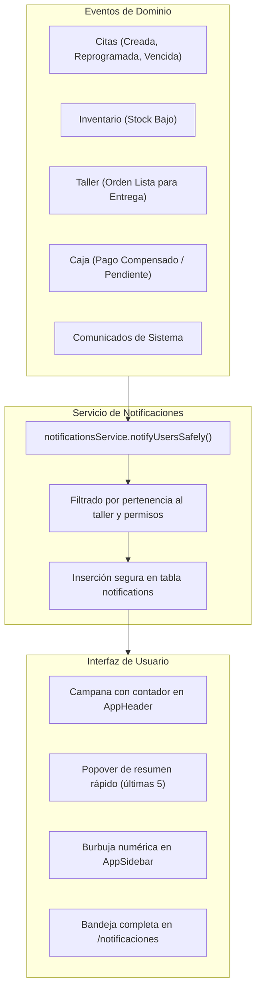

# Sprint 26 — Notificaciones Operativas de Taller

## 1. Visión y Propósito

El módulo de notificaciones de Torcly existía a nivel de esquema y servicios internos pero permanecía inactivo en la interfaz: no existía ruta registrada en el router, el sidebar no contenía el enlace ni la burbuja con el conteo de no leídas, y el header no presentaba la campana de avisos rápidos.

Este sprint reactiva y consolida el **Centro de Notificaciones del Taller**, dotando a los administradores y usuarios operativos de:

1. **Acceso directo y visible:** Campana con popover flotante en el header y enlace con insignia numérica en el sidebar.
2. **Nuevos eventos de negocio del taller:** Avisos automáticos de citas pendientes/no atendidas (`APPOINTMENT_OVERDUE`), ventas o pagos con saldo pendiente (`PAYMENT_DUE`), stock crítico (`STOCK_LOW`), compras recibidas (`PURCHASE_RECEIVED`), citas reprogramadas (`APPOINTMENT_RESCHEDULED`), órdenes listas para entrega (`WORK_ORDER_READY`) y avisos de sistema (`SYSTEM`).
3. **Página completa `/notificaciones`:** Con filtros por estado de lectura, filtros por tipo, paginación, navegación al recurso vinculado y acción de marcar todo como leído.
4. **Sondeo en vivo:** Actualización reactiva cada 30 segundos sin necesidad de recargar la página.

---

## 2. Historias de Usuario

- **HU-01 (Dueño / Administrador del taller):** Como responsable del taller, quiero ver un indicador visual (burbuja con número) en el menú y una campana en la cabecera para saber de inmediato cuántos eventos operativos requieren atención.
- **HU-02 (Personal operativo):** Como recepcionista o técnico, quiero recibir avisos cuando un vehículo esté listo para entrega, cuando se reprograme una cita o cuando una cita programada no haya sido atendida a tiempo.
- **HU-03 (Encargado de almacén):** Como encargado de repuestos, quiero recibir alertas cuando el stock de un producto caiga por debajo de su umbral mínimo o cuando ingrese una orden de compra.
- **HU-04 (Gestión de lectura):** Como usuario, quiero poder marcar avisos individualmente o en bloque como leídos para mantener limpia mi bandeja.

---

## 3. Arquitectura del Flujo

---

## 4. Estructura de Documentación del Sprint

- [acceptance-and-test-plan.md](./acceptance-and-test-plan.md): Criterios de aceptación y casos de prueba.
- [implementation-plan.md](./implementation-plan.md): Fases de desarrollo técnico.
- [approval.md](./approval.md): Dictamen y firmas de control de calidad.
